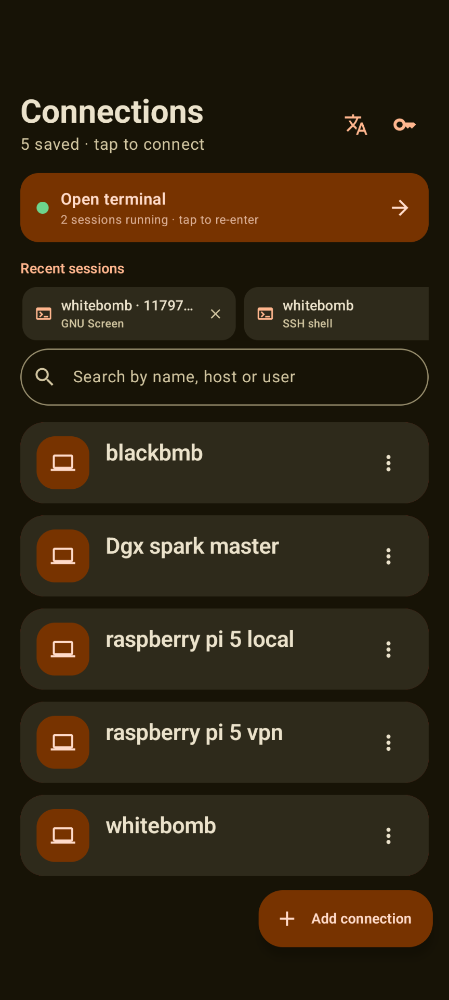
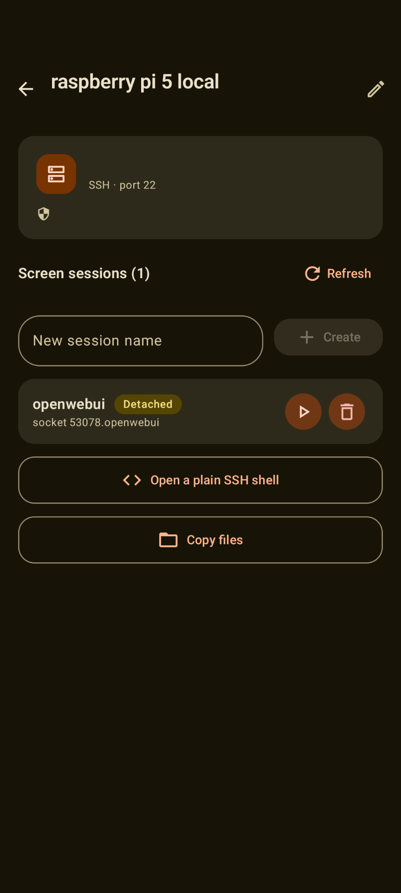
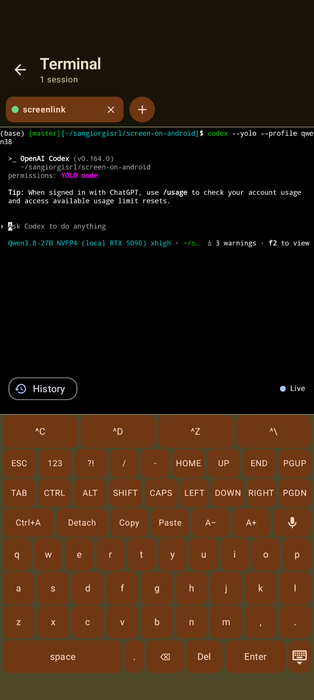
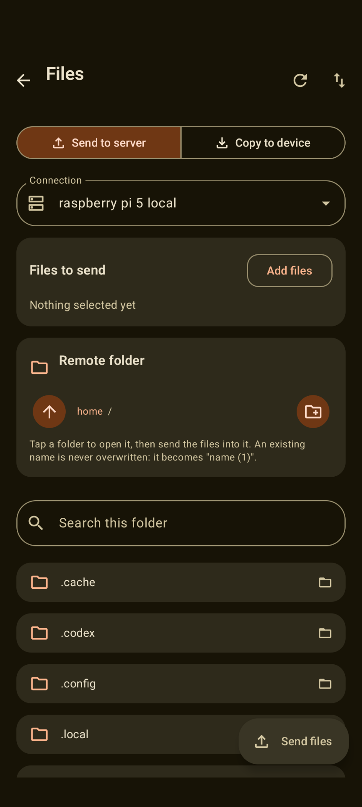
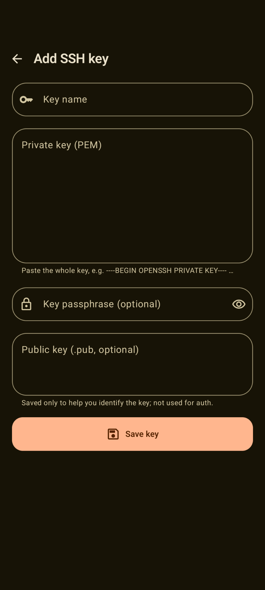

# ScreenLink

> A real, multi-tab **GNU Screen terminal over SSH**, right on your Android phone.

ScreenLink connects straight into a GNU Screen session on any Linux box over SSH and gives
you a genuine VT terminal emulator to work in - with none of the usual mobile compromises:
touch scrolling never sends arrow keys, the keyboard is fully in-app, and your sessions keep
running while you background the app.

**Built with - and for - my local LLMs.** ScreenLink was built using my local models together
with Codex, Claude and opencode, and it doubles as my phone's window into them: instead of
opening the laptop every time, I fire up ScreenLink to check in on those agents from anywhere
- the sessions keep running, and so do the agents.

      

---

## What it does

- **Home** - saved connections with search and swipe-to-delete plus **Undo**, and recent
  sessions pinned on top for one-tap starts.
- **Overview** - connects over SSH, verifies the host-key fingerprint
  (trust-on-first-use, loud warning on change), then **create / attach / detach / delete**
  GNU Screen sessions.
- **Terminal** - a true VT emulator on an SSH pty with **multiple sessions as tabs**. Each tab
  survives backgrounding and even Activity teardown via a foreground service, the notification
  deep-links back into the live terminal, and leaving the terminal never kills a session.
- **In-app keyboard** - the system IME is off on the terminal screen: one-tap **^C ^D ^Z ^\**,
  ESC, TAB, sticky CTRL/ALT latches, one-shot SHIFT, CAPS, Ctrl+A, Detach, arrows, PgUp/PgDn,
  Del, Copy, Paste, font A-/A+, opt-in number and symbol rows, spoken key labels for TalkBack,
  and a keyboard that is part of the layout so it can never cover the text.
- **Dictation on that keyboard** - tap the mic key, speak, and a strip over the terminal shows
  the **live transcript**; tap again and the sentence is typed **at the cursor**. Enter stays
  your decision, and X throws the attempt away before a character lands. ScreenLink never
  reads the microphone: it asks for the **best recognizer the phone actually has** - ML Kit
  `MODE_ADVANCED` (Gemini Nano, on-device), the platform recognizer, then ML Kit `MODE_BASIC` -
  steps down on its own when an engine is missing or busy, and the strip **names the engine
  that is listening**, because the privacy story is not the same between them.
- **File copies (SFTP)** - any file type, both directions, over the same pinned connection:
  share a file in from any app or pick files, browse the server, send; or tick remote files and
  choose one device folder. Progress rows with bytes, live speed and time left that can be
  **cancelled** and **retried**, a **Transfers** screen with a badge, copies that keep running
  when you navigate away, and **nothing is ever overwritten** (a taken name becomes
  `name (1)`, and a cancelled copy leaves no half-written file on either side).
- **SSH keys** - import ed25519/RSA/EC private keys (PEM, passphrase-aware) for password-less
  login, encrypted at rest with the Android Keystore.
- **Tablet, landscape, Spanish** - every screen adapts with the Material 3 window-size classes,
  the keyboard switches to a compact one-pad layout on a landscape phone, and the whole UI ships
  in **English and Spanish** (in-app picker, plus the per-app system setting on Android 13+).

## Screenshots

| Home | Connection / sessions | Terminal + keyboard |
|---|---|---|
| <br>Saved connections, recent sessions pinned on top, and **Open terminal** for every live tab. | <br>The pinned fingerprint, shown **before** any credential, and the Screen sessions found on the server. | <br>A coding agent on a **local model**, the **History** / **Live** strip, and the in-app keyboard with its **mic key**. |

| File copies (SFTP) | Add SSH key |
|---|---|
| <br>Direction in one tap, the destination browsed by breadcrumb, nothing sent until **Send files**. | <br>A PEM pasted in with an optional passphrase; Keystore-encrypted and kept out of backups. |

## Privacy, honestly

- Passwords and key passphrases are encrypted **at rest with the Android Keystore**
  (AES-256/GCM), and keys and passwords are excluded from backups and device transfer.
- Host keys are **trusted on first use**: the key exchange completes *without authenticating*,
  the real `ssh-keygen -lf` SHA-256 fingerprint is shown before any credential is sent, and a
  changed key is a **hard failure during the handshake**. One code path (`ssh/SshConnector`)
  owns that decision for the terminal, the overview and file transfer alike.
- **Dictation keeps the audio out of this app.** `RECORD_AUDIO` is declared for the mic key, but
  the microphone is opened by the **recognizer**: ScreenLink never reads an audio buffer, records
  nothing, stores nothing and uploads nothing, and every engine it can bind is an on-device one
  reached by Binder IPC, not a socket. What you dictated is then typed into the terminal, so it
  travels to **the SSH host you are connected to**, exactly like keystrokes.
- Google's own SDK does use the network around dictation: the **one-time model download** and
  **ML Kit's diagnostics** (device/app info, identifiers, latency, error codes and the *size* of
  the input and output - never their content). There is no documented opt-out for that traffic in
  the version in use, so it is declared in the Play Data Safety form rather than promised away.
- Sessions belong to you: `forceStop` and system back on the terminal **never disconnect**.

## Requirements

- **Device** - Android 8.0+ (API 26). Dictation needs a speech recognizer; **advanced mode**
  (Gemini Nano through the AICore system service) means a **Pixel 10 or Pixel 11 with a locked
  bootloader** today, and ML Kit's Basic model needs Android 12+ (API 31) plus Google's Speech
  Recognition & Synthesis. Everything else falls back to the device's own recognizer
  automatically, and the strip says which engine is in use.
- **Server** - a reachable OpenSSH server with **GNU Screen** installed (`screen -ls` must work)
  and a user account.

## Build

Needs the Android SDK (`sdk.dir` in `local.properties`) and a JDK 17+.

```bash
./gradlew :app:assembleDebug                # debug APK -> app/build/outputs/apk/debug/
./gradlew :app:assembleRelease              # unsigned release, minified + resource-shrunk
./gradlew :app:testDebugUnitTest            # 629 JVM unit tests (JUnit 5)
./gradlew :app:lint                         # 0 errors / 0 warnings, all variants
./gradlew :app:connectedDebugAndroidTest    # on-device SSH + SFTP + screen lifecycle
```

CI ([`ci.yml`](.github/workflows/ci.yml)) runs that same gate on every push and pull request;
the emulator suite stays a local step. Pushing a `v*` tag that matches `versionName` publishes
the **debug APK** to a [release](https://github.com/fulvius31/ScreenLink/releases)
([`release.yml`](.github/workflows/release.yml)) - debuggable on purpose, because an unsigned
release APK cannot be installed. It is signed with a throwaway key checked into `keystore/`,
so a new release installs over the one already on the phone and keeps your pinned host keys.

Kotlin 2.1.20 and Jetpack Compose (Material 3), Room plus the Android Keystore,
`com.github.mwiede:jsch` with BouncyCastle for the full range of ciphers and kexes, and the
terminal emulator and rendering view **vendored into this app's own package** - rewritten in
Kotlin from [termux/termux-app](https://github.com/termux/termux-app) `v0.118.0` (Apache-2.0),
with the attribution in [`NOTICE`](NOTICE) and, as Apache-2.0 requires of the distributed
artifact, inside the APK as `app/src/main/assets/NOTICE.txt`.

## Use it

1. Download the debug APK from the [latest release](https://github.com/fulvius31/ScreenLink/releases) and install it (`adb install -r screenlink-*.apk` also works).
2. **Add connection** - name, user, host, port, password; optionally an imported key and a
   default screen session to auto-attach.
3. Tap the connection - it connects, verifies the fingerprint, lists screen sessions.
4. **Create** a session, **attach** for a live terminal, **detach**, **delete**. Inside the
   terminal just **drag** to read Screen's real server-side history: a status row carries the
   **History** chip and, on the right, **Live** at the prompt or a **Live** pill that drops you
   back to it.

## Known limits

- Android 14/15 cap `dataSync` foreground services (roughly 6 h/day on 15), so a killed process
  ends the tunnels; GNU Screen itself keeps running server-side and is re-attachable at any time.
- **Advanced dictation is alpha software on a short list of devices** (`1.0.0-alpha1`, no
  compatibility promise): Pixel 10/11 only, never with an unlocked bootloader, model downloaded
  on demand (hundreds of MB), one app at a time, inference only in the foreground. Any of those
  falls through to the device's own recognizer, so the feature survives.
- Recognition of shell punctuation is inherently fuzzy - say "slash", "pipe", "space" out loud,
  or finish the command with the keyboard. Dictated text is never auto-executed.

## License

[Apache-2.0](LICENSE) - see [`LICENSE`](LICENSE) and [`NOTICE`](NOTICE). The vendored terminal
code originates from [termux/termux-app](https://github.com/termux/termux-app) (Apache-2.0), was
rewritten in Kotlin, and now lives in this app's own package; each vendored package repeats the
credit in its `package-info.java` and it ships inside the APK as `assets/NOTICE.txt`. Third-party
dependencies keep their own licenses. ML Kit's GenAI APIs are additionally governed by Google's
[ML Kit GenAI APIs Additional Terms of Service](https://developers.google.com/ml-kit/terms),
accepted on first use of the API on device.
